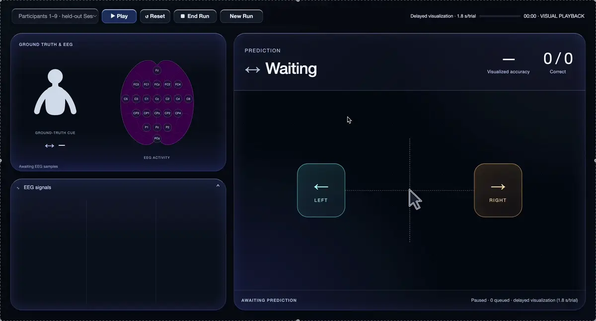
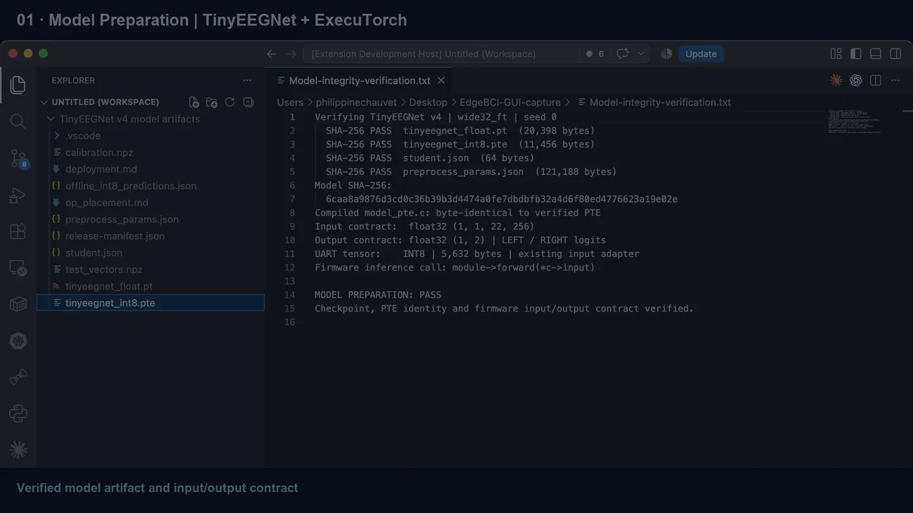
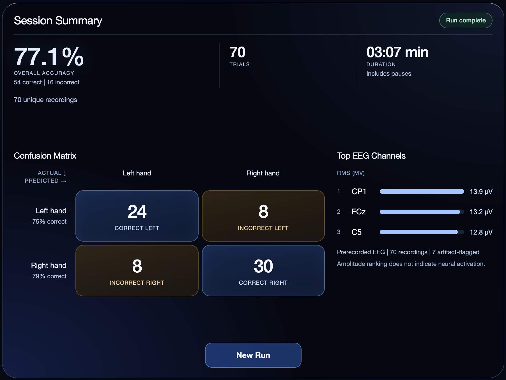
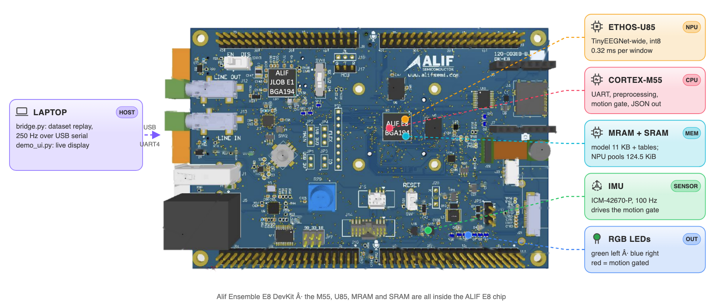

<p align="center"></p>

# CorteX ARM

**Hackathon submission.** Motor-imagery EEG in real time → Alif Ensemble E8 → Ethos-U85 inference → predicted hand, IMU artifact gate. Judged release: tag `v1.0-submission`.

> Built for the [**Arm + ExecuTorch: Edge AI Challenge**](https://arm-executorch.devpost.com/) · San Francisco State University · October 17–18, 2026 · Team **CorteX ARM**

<p align="center">
     
     
     
      
    
    
 
</p>

<p align="center"><b><a href="#hardware">Hardware</a> · <a href="#demo">Demo</a> · <a href="#results">Results</a> · <a href="#architecture">Architecture</a> · <a href="#ml-models">ML models</a> · <a href="#build-and-run">Build and run</a> · <a href="#team">Team</a> · <a href="#license">License</a></b></p>

<p align="center"><a href="docs/architecture.md"></a> <a href="docs/deploy_runbook.md"></a> <a href="docs/demo_script.md"></a> <a href="ml/README.md"></a> <a href="results/fvp_selftest.md"></a> <a href="results/replay_accuracy.md"></a></p>

## What it does

Stroke-rehab BCI. User imagines left or right hand movement; board classifies it on the NPU, in real time. Motor-imagery training helps stroke patients regain hand control, but today's BCIs need a PC or the cloud next to the patient. A milliwatt-class board that decodes on-device keeps raw brain data private, works without a network and can run at home or at the bedside on a battery. Board accelerometer sees motion → prediction suppressed. **No headset**: laptop replays held-out BCI IV 2a trials (session 2, never trained on) at 250 Hz, sample by sample, over the UART path a headset would use. Firmware cannot tell the difference; headset driver can come later, board untouched. IMU is on the board, so it measures board motion: wearable build puts board on head; demo moves board to show the gate.

### Hardware

<table><tr>
<td width="45%"></td>
<td>

**Alif Ensemble E8 DevKit**, everything below runs on it:
- **Cortex-M55** (high-performance core, 400 MHz): UART input, preprocessing, motion gate, output
- **Ethos-U85 NPU** (`ethos-u85-256`): all of TinyEEGNet, int8
- **On-board IMU** (ICM-42670-P over I3C): the motion gate
- **RGB LED**: green left, blue right, red motion
- **MRAM** holds code, the 11 KB model and the alignment tables; **SRAM** holds the NPU working memory

</td>
</tr></table>

## Demo

### Live demo on the Alif E8

One run of the demo: held-out EEG trials stream to the board, the E8 predicts left or right hand on the Ethos-U85, and the UI shows the cue, scalp map, 22 EEG channels, running accuracy and the session summary (26 trials, 76.9 %).

<p align="center"><a href="docs/video/live_demo.mp4"></a><br><sub>Click for the full-quality video.</sub></p>

### From trained model to board (verification)

The checks before the demo, in five steps: model identity, FVP validation against the TOSA reference, firmware build, flashing the E8 with J-Link and reading the model back from MRAM, then inference on the board.

<p align="center"><a href="docs/video/deploy_verification.mp4"></a><br><sub>Click for the full-quality video.</sub></p>

## Results

Generic model (distilled student, `v0.5-distill`). On the physical E8 the laptop preprocesses each trial and sends the int8 window; the E8 runs the model on the Ethos-U85 ([`board_demo/`](board_demo/)). The on-board preprocessing firmware (Figure 2) is verified on the FVP.

### Accuracy

| Model | Test | Accuracy | Measured on |
|---|---|---|---|
| Generic | 70 held-out trials | **77.1 %** (54/70; left 24/32, right 30/38) | physical E8 |
| Generic | 1,080 unseen trials, all 9 BCI IV 2a subjects | 74.6 % int8 | laptop, int8 reference |
| Subject-specific | subject 1, session 2 | 79.2 % int8 (114/144) | physical E8 |

Confusion matrix of the 70-trial board run (rows = actual, columns = predicted): left 24 / 8, right 8 / 30. Details: [`results/board_metrics.md`](results/board_metrics.md).

### Correctness and efficiency

| Metric | Value | Measured on |
|---|---|---|
| Model on the board = release | `.pte` read back from MRAM, sha256 matches | physical E8 |
| Board output = FVP (subject-specific model) | 160/160 windows | physical E8 |
| FVP = TOSA reference (generic model) | 1,080/1,080 trials bit-exact | Corstone-320 FVP |
| Inference on the Ethos-U85 | 128,056 NPU cycles ≈ 0.32 ms at 400 MHz | FVP |
| Preprocessing on the M55 | 243 cycles per sample (0.6 µs); 99.7 k cycles per window (0.25 ms) | FVP |
| Model | 11,456 B `.pte`, 3,426 parameters, all compute on the NPU | |
| Memory | NPU pools 124.5 KiB SRAM; code + model + tables 227 KiB MRAM | FVP, linker map |
| Optimisation v0.1 → v0.5 | NPU cycles 226,056 → 128,056 (−43 %), pools 237 → 124.5 KiB, accuracy 71.5 → 74.6 % | FVP |

End-to-end latency on the board is not measured yet; the FVP estimate is under 1 ms. Full tables: [`results/summary.md`](results/summary.md).

**Files** (release [`v1.0-submission`](https://github.com/ArmExecuTorchEEG/CorteX-ARM/releases/tag/v1.0-submission)): [`tinyeegnet_int8.pte`](https://github.com/ArmExecuTorchEEG/CorteX-ARM/releases/download/v1.0-submission/tinyeegnet_int8.pte) · [`cmsis-executorch.axf`](https://github.com/ArmExecuTorchEEG/CorteX-ARM/releases/download/v1.0-submission/cmsis-executorch.axf) (board firmware) · [`preprocess_params.json`](https://github.com/ArmExecuTorchEEG/CorteX-ARM/releases/download/v1.0-submission/preprocess_params.json) · [`SHA256SUMS`](https://github.com/ArmExecuTorchEEG/CorteX-ARM/releases/download/v1.0-submission/SHA256SUMS)

<details><summary>Session summary in the demo UI (70-trial board run)</summary>

<p align="center"></p>

</details>

## Architecture

<p align="center"><picture>
<source media="(prefers-color-scheme: dark)" srcset="docs/media/pipeline-dark.svg">

</picture><br><sub><b>Figure 1.</b> System architecture. The chip on each card shows where it runs: HOST (laptop), M55 (Cortex-M55), U85 (Ethos-U85 NPU), BOARD (peripherals). The highlighted PREPROCESSING block is expanded in Figure 2.</sub></p>

One `.pte` (TinyEEGNet-wide student wide32_ft, release `v0.5-distill`, 11,456 B, 125 Hz input, 256 samples = 2.048 s; 74.6 % int8 mean over 9 subjects × 3 seeds in Reproduce_Baselines) serves all nine subjects. `SET_SUBJECT` only switches the subject's 22×22 Euclidean-alignment matrix. Previous model `v0.3-distill`: same contract, `./tools/fetch_model.sh v0.3-distill`. Detailed block diagram, end-to-end ASCII diagram, signal-path equations, memory map, timing budget: [`docs/architecture.md`](docs/architecture.md). **Step-by-step deploy (get model → build → flash → stream raw dataset signals → read predictions): [`docs/deploy_runbook.md`](docs/deploy_runbook.md).**

### Workload placement

<p align="center"><picture>
<source media="(prefers-color-scheme: dark)" srcset="docs/media/board-dark.png">

</picture><br><sub><b>Workload placement on the board.</b> Board image: Alif Semiconductor.</sub></p>

| Work | Where | Why |
|---|---|---|
| EEG source | Laptop (`bridge.py --source replay`) | No headset; recorded trials paced at 250 Hz like a live stream |
| Framing to UART | Laptop (`bridge.py`) | Thin: no filtering, no ML |
| CAR, band-pass (4 SOS), decimate to 125 Hz, window | Cortex-M55, per sample, float64 | Must match `host/pipeline_ref.py` bit for bit; 243 cycles/sample (FVP) |
| Euclidean alignment (per subject), scale, int8 quantize | Cortex-M55, per window | 99.7 k cycles ≈ 0.25 ms at 400 MHz (FVP) |
| Inference | Ethos-U85 | All conv/linear ops delegated; 128 k NPU cycles per window (FVP). The `.pte` I/O is float, quantize/dequantize run on the M55 |
| IMU read + motion gate | Cortex-M55 | On-board ICM-42670-P over I3C, polled at 100 Hz |
| Display, metrics | Laptop (`demo_ui.py`, `measure.py`) | Not scored; keeps board workload honest |

### Preprocessing (inside the M55)

<p align="center"><picture>
<source media="(prefers-color-scheme: dark)" srcset="docs/media/signal-dark.svg">

</picture><br><sub><b>Figure 2.</b> Preprocessing: raw UART samples to the int8 model input.</sub></p>

The laptop sends raw dataset samples; every processing step runs on the board.
- **Per sample (250 Hz):** convert to µV, subtract the average of the 22 channels (removes the shared reference), keep the 7–30 Hz band where hand-imagery rhythms live, keep every second sample (125 Hz).
- **Per window (one per trial):** take 2.048 s, multiply by the subject's 22×22 **Euclidean alignment** matrix (made once from 24 unlabeled trials, so one model fits every person), scale, and quantize to int8.
- The board's int8 window equals the laptop reference (`host/pipeline_ref.py`) bit for bit. Equations: [`docs/architecture.md`](docs/architecture.md#signal-path-equations).

## ML models

<p align="center"><picture>
<source media="(prefers-color-scheme: dark)" srcset="docs/media/ml-dark.svg">

</picture><br><sub><b>Figure 3.</b> The two trained models: subject-specific (A) and generic (B).</sub></p>

| Model | Trained on | Tested on | Accuracy | `.pte` | Ran on |
|---|---|---|---|---|---|
| **A** subject-specific: TinyEEGNet | BCI IV 2a subject 1, session 1 | subject 1, session 2 | 79.9 % | 13,072 B | FVP, physical E8 |
| **B** generic: 4 teachers → TinyEEGNet-wide student (firmware default) | Cho2017 + Lee2019_MI, 72 subjects | all 9 BCI IV 2a subjects | 74.6 % int8 | 11,456 B | FVP |

B needs no labeled data from the user: a 22×22 alignment matrix from 24 unlabeled trials adapts it to each person. Datasets, training steps, code, metric checks and failure cases: **[`ml/README.md`](ml/README.md)**.

## Interfaces

| Link | Format |
|---|---|
| Laptop → board | UART4, **921600 baud** 8N1. Data frame `0xAA55, n_ch, seq, int16[22]` per 250 Hz sample (raw dataset counts, µV × 20.48). Control frames `0xAA56`: `RESET`, `SET_SUBJECT 1–9`, `CUE <label>`, `FREE_RUN` |
| Board → laptop | Boot line `READY …`, then one JSON line per prediction: `{"t","seq","trial","subject","cls","raw_cls","conf","logits","lat_us","motion","label"}`. `cls` = −1 when the motion gate fires. `#` lines are diagnostics |
| Board LEDs | green = left, blue = right, red = motion-gated |
| IMU | on-board ICM-42670-P over I3C, ±4 g, 100 Hz |
| Laptop internal | `bridge.py` owns the serial port and republishes every line over UDP `127.0.0.1:5555` to `demo_ui.py` and `measure.py` |

One prediction per trial, 2.544 s after the cue, when its window is complete; `FREE_RUN 1` adds one every 256 ms. Byte-level protocol, field meanings, latency definition and motion-gate rule: [`docs/architecture.md`](docs/architecture.md#interfaces-full-protocol).

## Build and run

Three ways in, from no hardware to the full board demo:

| Path | You need | Time | Result |
|---|---|---|---|
| **A. Emulator only** | Docker + Keil MDK Community licence | ~10 min | Whole board pipeline runs on the Corstone-320 FVP: `Test_result: PASS` |
| **B. Board demo** | Alif E8 DevKit, USB-C cable | ~20 min | Live left/right predictions in the demo UI, LEDs on the board |
| **C. Retrain the models** | ~35 GB of EEG data, a GPU or Apple Silicon | hours | New `.pte` bundle, see [`ml/README.md`](ml/README.md) |

<details open>
<summary><b>0. Setup (all paths)</b></summary>

| Tool | Version | For |
|---|---|---|
| VS Code + Arm Keil Studio Pack | CMSIS-Toolbox 2.15, Arm Compiler 6 | building the firmware |
| ExecuTorch | 1.5.1 (pinned in the pack) | runtime on the board |
| Python | 3.12, `pip install -r host/requirements.txt` | bridge, demo UI, checks |
| Docker (colima or Docker Desktop) | image `cmsis-fvp:11.32.23` | path A on macOS |
| Alif SETOOLS, SEGGER J-Link | ≥ 1.110, ≥ 8.42 | path B |

```bash
git clone https://github.com/ArmExecuTorchEEG/CorteX-ARM && cd CorteX-ARM
./tools/fetch_model.sh                       # optional: the model is already embedded; this re-downloads and checks sha256
python3 tools/gen_params_h.py --check        # firmware/src/params_gen.h matches firmware/model/params.json
source ~/.vcpkg/vcpkg-init && (cd firmware && vcpkg-shell activate)   # command-line toolchain
```
</details>

<details open>
<summary><b>A. Run the whole pipeline on the emulator</b></summary>

The `SelfTest` build feeds an embedded stream (subject A03, 5 trials) through the real parser, preprocessing, NPU and JSON output:

```bash
cbuild firmware/edge_eeg.csolution.yml --context edge_eeg.SelfTest+SSE-320-U85 --packs
cd firmware && docker run --rm -i --init --user $(id -u) --mount "type=bind,src=$HOME/,dst=$HOME/" --workdir "$PWD" \
  --env "ARMLM_CACHED_LICENSES_LOCATION=$HOME/.armlm" cmsis-fvp:11.32.23 stdbuf -oL -eL \
  FVP_Corstone_SSE-320 -f board/Corstone-320/fvp_config.txt --simlimit 600 --stat \
  -a out/edge_eeg/SSE-320-U85/SelfTest/edge_eeg.axf
```
✅ Expect `Test_result: PASS` and 0 of 28,160 int8 values different from the laptop reference ([`results/fvp_selftest.md`](results/fvp_selftest.md)).
</details>

<details open>
<summary><b>B. Flash the board and run the demo</b></summary>

1. **Build:** `cbuild firmware/edge_eeg.csolution.yml --active DevKit-E8 --packs`, or in VS Code: CMSIS view > target **DevKit-E8** > Build.
2. **Wire:** USB-C on **PRG USB**, jumpers JP5 1-2 and JP7 3-4, SW4 → **SEUART**.
3. **First time only:** Terminal > Run Task > *Alif: Install M55_HP debug stubs*.
4. **Flash:** SW4 → **UART4**, then CMSIS view > Run.
5. **Check:** a serial console at **921600** shows `READY … pte_bytes=11456 …` and `# imu ok`. Close it again.
6. **Run:**
   ```bash
   python host/export_replay.py --subject 3           # once: raw BCI IV 2a samples -> host/data/A03_session2.npz
   python host/demo_ui.py --listen 5555                # terminal 1
   python host/bridge.py --source replay --subject 3 --session 2 --board /dev/tty.usbmodemXXXX   # terminal 2
   ```
7. **Show the motion gate:** shake the board; the LED turns red and the prediction is suppressed.

✅ Expect 119 of 120 trials correct for subject 3, every prediction equal to [`host/reference/expected_board_predictions.json`](host/reference/expected_board_predictions.json). No board? Add `--board sim` to run the same stream against the laptop reference. Full run of show: [`docs/demo_script.md`](docs/demo_script.md); step-by-step with troubleshooting: [`docs/deploy_runbook.md`](docs/deploy_runbook.md).
</details>

<details>
<summary><b>Verify the numbers</b></summary>

```bash
python host/measure.py --listen 5555 --trials 120 --out results/board_metrics.md   # during a board run: accuracy, latency
python host/replay_accuracy.py                       # expected board output for all 9 subjects -> results/replay_accuracy.md
make -C firmware/tests test                          # firmware C++ preprocessing vs host/pipeline_ref.py
python -m pytest host/tests -q                       # host tests
```
</details>

## Repository map

| Folder | What it does | Key files |
|---|---|---|
| [`firmware/`](firmware/) | The board application (CMSIS solution, targets `DevKit-E8` and `SSE-320-U85`) | `edge_eeg.csolution.yml`, `edge_eeg.cproject.yml` |
| [`firmware/src/`](firmware/src/) | Application code on the Cortex-M55 | `uart_rx` (frames), `preprocess` (Figure 2), `infer` (ExecuTorch → Ethos-U85), `imu` + `motion_gate`, `leds`, `json_out`, `selftest` |
| [`firmware/board/`](firmware/board/) | Board layers: UART4 at 921600, I3C IMU, LEDs, NPU setup | `DevKit-E8/`, `Corstone-320/` |
| [`firmware/ai_layer/`](firmware/ai_layer/) | The int8 model as a C array, so the build works offline | `model_pte.c` |
| [`firmware/model/`](firmware/model/) | Preprocessing constants: filter, alignment matrices, scales | `params.json` |
| [`firmware/tests/`](firmware/tests/) | Firmware preprocessing tested on the laptop against the Python reference | `preprocess_test.cpp`, `Makefile` |
| [`host/`](host/) | Laptop side: stream the dataset to the board, show and measure the output | `bridge.py`, `demo_ui.py`, `measure.py`, `export_replay.py` |
| [`host/`](host/) (reference) | Bit-exact Python copy of the board pipeline and expected outputs | `pipeline_ref.py`, `int8_oracle.py`, `reference/`, `drivers/sim_board.py` |
| [`host/tests/`](host/tests/) | Protocol, framing and reference tests | `test_*.py` |
| [`ml/`](ml/) | Training code for both models, datasets and metrics | [`README.md`](ml/README.md), `distillation/`, `subject_model/` |
| [`tools/`](tools/) | Fetch the model release, regenerate the firmware constants | `fetch_model.sh`, `gen_params_h.py` |
| [`board_demo/`](board_demo/) | Physical-board run: inference firmware, validation tools, demo UI | `firmware/multisubject/`, `tools/multisubject_trials/`, `frontend/` |
| [`results/`](results/) | Recorded measurements | `fvp_selftest.md`, `replay_accuracy.md`, `board_metrics.md` |
| [`docs/`](docs/) | Detailed design, runbook, demo script, figures | `architecture.md`, `deploy_runbook.md`, `demo_script.md`, `media/` |

## For the judges

| Rubric item | Where to look |
|---|---|
| Functionality and reliability | [Live demo](#live-demo-on-the-alif-e8) and [verification](#from-trained-model-to-board-verification) videos; 77.1 % on the physical E8 and `.pte` MRAM readback ([Results](#results)); subject-specific model board output = FVP on 160/160 windows |
| Performance and efficiency | [Results](#results), key numbers: NPU cycles, preprocessing cycles, memory, `.pte` size, v0.1 → v0.5 optimisation (−43 % NPU cycles) |
| Effective use of the E8 | [Workload placement](#workload-placement), Figure 1; memory map in [`docs/architecture.md`](docs/architecture.md#memory-map-devkit-e8-debug-build) |
| Multimodal and sensors | EEG stream + on-board IMU motion gate ([Hardware](#hardware), [Workload placement](#workload-placement)); gate implemented and tested on the FVP, not yet verified on the board |
| Innovation and use-case value | Stroke-rehab BCI on a microcontroller; one model adapts to a new person from 24 unlabeled trials |
| Technical ambition | Two models, four-teacher distillation, bit-exact on-board preprocessing ([`ml/README.md`](ml/README.md)) |
| Engineering quality and demo | Tests in `firmware/`, `host/`, `ml/`; emulator self-test; release `v1.0-submission`; [`docs/demo_script.md`](docs/demo_script.md) |

| Required item | Where |
|---|---|
| Live demonstration on the Alif E8 | [Live demo](#live-demo-on-the-alif-e8), [`docs/demo_script.md`](docs/demo_script.md) |
| Public source code | this repository |
| Fixed release version | [`v1.0-submission`](https://github.com/ArmExecuTorchEEG/CorteX-ARM/releases/tag/v1.0-submission) (`.pte` and firmware `.axf` attached) |
| Build and run instructions | [Build and run](#build-and-run) |
| Architecture | [Architecture](#architecture), Figures 1–2 |
| Workload placement | [Workload placement](#workload-placement), Figure 1 |
| Performance measurements | [Results](#results) key numbers, [`results/`](results/) |

## Team

| Name | Role |
|---|---|
| Moamen Soliman | EEG Model Architecture, Training & Optimization |
| Philippine Chauvet | Embedded AI Engineering, Firmware & Hardware Integration |
| Jihyung Ku | Frontend Engineering & UI/UX Design |

## Credits

- **Datasets** (used under each provider's terms, not redistributed): BCI Competition IV 2a (Tangermann et al., 2012), Cho et al. 2017, Lee et al. 2019, all through [MOABB](https://moabb.neurotechx.com).
- **Software:** [ExecuTorch](https://github.com/pytorch/executorch) with the Arm Ethos-U backend, Arm Vela, the [Arm CMSIS-Executorch starter](https://github.com/Arm-Examples/CMSIS-Executorch), the Alif Ensemble CMSIS pack.
- **Methods:** EEGNet (Lawhern et al., 2018), ShallowConvNet and DeepConvNet (Schirrmeister et al., 2017), Euclidean alignment (He and Wu, 2020).
- **Images:** board photo and layout © Alif Semiconductor.

## License

MIT. Starter code © Arm Limited, Apache-2.0 (SPDX headers in those files); ExecuTorch runtime licence in [`firmware/src/LICENSE-ExecuTorch`](firmware/src/LICENSE-ExecuTorch).
