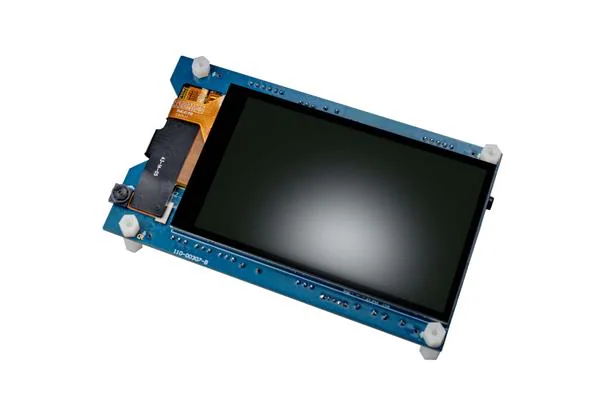
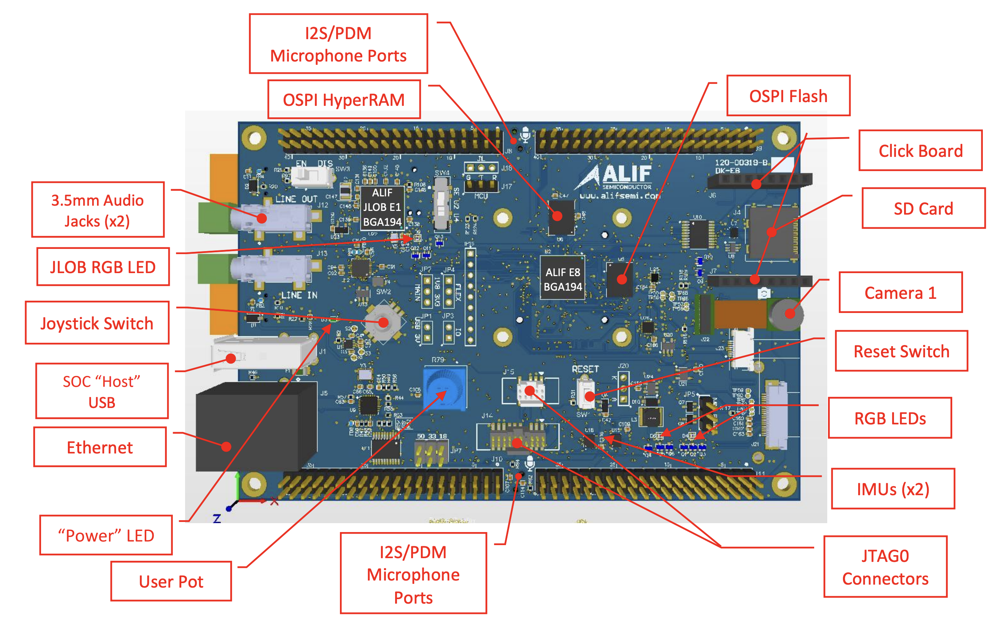

<p align="center"></p>

# CorteX ARM

**Hackathon submission.** Motor-imagery EEG in real time → Alif Ensemble E8 → Ethos-U85 inference → predicted hand, IMU artifact gate. Judged release: tag `v1.0-submission`.

> Arm + ExecuTorch Edge AI Challenge · SFSU · Oct 17–18 2026 · Team ArmExecuTorchEEG

## What it does

Stroke-rehab BCI. User imagines left or right hand movement; board classifies it on the NPU, in real time. Board accelerometer sees motion → prediction suppressed. **No headset**: laptop replays held-out BCI IV 2a trials (session 2, never trained on) at 250 Hz, sample by sample, over the UART path a headset would use. Firmware cannot tell the difference; headset driver can come later, board untouched. IMU is on the board, so it measures board motion: wearable build puts board on head; demo moves board to show the gate.

### Hardware

<table><tr>
<td width="45%"></td>
<td>

**Alif Ensemble E8 DevKit**, everything below runs on it:
- **Cortex-M55** (high-performance core, 400 MHz): UART input, preprocessing, motion gate, output
- **Ethos-U85 NPU** (`ethos-u85-256`): all of TinyEEGNet, int8
- **On-board IMU** (ICM-42670-P over I3C): the motion gate
- **RGB LED**: green left, blue right, red motion
- **MRAM** holds code, the 11 KB model and the alignment tables; **SRAM** holds the NPU working memory

</td>
</tr></table>

<p align="center"><br>
<sub>Board layout. This project uses the <b>ALIF E8</b> SoC (Cortex-M55 + Ethos-U85), the on-board <b>IMU</b> and the <b>RGB LEDs</b>. Images: Alif Semiconductor.</sub></p>

## Demo

| | Video |
|---|---|
| 1. Demo UI: live predictions from the board | `VIDEO 1 PLACEHOLDER: demo UI` |
| 2. The Alif E8 board: replay stream, LEDs, IMU motion gate (shake → red, prediction suppressed) | `VIDEO 2 PLACEHOLDER: physical board` |
| 3. Emulator check before deployment: the model passes on the Corstone-320 FVP, then goes to the board | `VIDEO 3 PLACEHOLDER: emulator and deployment` |

## Results

| Metric | Value | Where measured |
|---|---|---|
| Accuracy, generic model (9 BCI IV 2a subjects, 1,080 unseen trials) | 74.6 % int8 (mean of 3 seeds); shipped seed 74.4 %, best subject 99.2 % | laptop, [`ml/README.md`](ml/README.md) |
| Accuracy, subject-specific model (subject 1, session 2) | 79.9 % float; 79.2 % int8 on the board | laptop; physical E8 |
| Board output = laptop reference | `TODO` (target: 120/120 per subject) | physical E8 |
| End-to-end latency (last sample in → prediction out) | `TODO` (estimate ≈ 1 ms; target < 50 ms) | physical E8 |
| Inference on the Ethos-U85 | 128,056 NPU cycles ≈ 0.32 ms at 400 MHz | FVP |
| Preprocessing on the M55 | 243 cycles per sample (0.6 µs); 99.7 k cycles per window (0.25 ms) | FVP |
| Model size | 11,456 B `.pte`, 3,426 parameters | |
| Memory | NPU pools peak 124.5 KiB (SRAM0); code + `.pte` + tables 227 KiB MRAM; app data 110 KiB DTCM | FVP, linker map |
| Preprocessing correctness | 0 of 28,160 int8 values differ from the laptop reference | FVP self-test |

**Optimisation** (same pipeline, first release vs shipped):

| | v0.1 baseline | v0.5 shipped |
|---|---|---|
| Input | 22 × 500 at 250 Hz | 22 × 256 at 125 Hz |
| Accuracy (int8, 9 subjects) | 71.5 % | 74.6 % |
| NPU cycles per inference | 226,056 | 128,056 |
| NPU memory pools | 237 KiB | 124.5 KiB |
| `.pte` | 10,624 B | 11,456 B |

## Architecture

<p align="center"><picture>
<source media="(prefers-color-scheme: dark)" srcset="docs/media/pipeline-dark.svg">

</picture><br><sub><b>Figure 1.</b> System architecture. The highlighted PREPROCESSING block is expanded in Figure 2.</sub></p>

One `.pte` (TinyEEGNet-wide student wide32_ft, release `v0.5-distill`, 11,456 B, 125 Hz input, 256 samples = 2.048 s; 74.6 % int8 mean over 9 subjects × 3 seeds in Reproduce_Baselines) serves all nine subjects. `SET_SUBJECT` only switches the subject's 22×22 Euclidean-alignment matrix. Previous model `v0.3-distill`: same contract, `./tools/fetch_model.sh v0.3-distill`. Detailed block diagram, end-to-end ASCII diagram, signal-path equations, memory map, timing budget: [`docs/architecture.md`](docs/architecture.md). **Step-by-step deploy (get model → build → flash → stream raw dataset signals → read predictions): [`docs/deploy_runbook.md`](docs/deploy_runbook.md).**

### Workload placement

| Work | Where | Why |
|---|---|---|
| EEG source | Laptop (`bridge.py --source replay`) | No headset; recorded trials paced at 250 Hz like a live stream |
| Framing to UART | Laptop (`bridge.py`) | Thin: no filtering, no ML |
| CAR, band-pass (4 SOS), decimate to 125 Hz, window | Cortex-M55, per sample, float64 | Must match `host/pipeline_ref.py` bit for bit; 243 cycles/sample (FVP) |
| Euclidean alignment (per subject), scale, int8 quantize | Cortex-M55, per window | 99.7 k cycles ≈ 0.25 ms at 400 MHz (FVP) |
| Inference | Ethos-U85 | All conv/linear ops delegated; 128 k NPU cycles per window (FVP). The `.pte` I/O is float, quantize/dequantize run on the M55 |
| IMU read + motion gate | Cortex-M55 | On-board ICM-42670-P over I3C, polled at 100 Hz |
| Display, metrics | Laptop (`demo_ui.py`, `measure.py`) | Not scored; keeps board workload honest |

### Preprocessing (inside the M55)

<p align="center"><picture>
<source media="(prefers-color-scheme: dark)" srcset="docs/media/signal-dark.svg">

</picture><br><sub><b>Figure 2.</b> Preprocessing: raw UART samples to the int8 model input.</sub></p>

The laptop sends raw dataset samples; every processing step runs on the board.
- **Per sample (250 Hz):** convert to µV, subtract the average of the 22 channels (removes the shared reference), keep the 7–30 Hz band where hand-imagery rhythms live, keep every second sample (125 Hz).
- **Per window (one per trial):** take 2.048 s, multiply by the subject's 22×22 **Euclidean alignment** matrix (made once from 24 unlabeled trials, so one model fits every person), scale, and quantize to int8.
- The board's int8 window equals the laptop reference (`host/pipeline_ref.py`) bit for bit. Equations: [`docs/architecture.md`](docs/architecture.md#signal-path-equations).

## ML models

<p align="center"><picture>
<source media="(prefers-color-scheme: dark)" srcset="docs/media/ml-dark.svg">

</picture><br><sub><b>Figure 3.</b> The two trained models: subject-specific (A) and generic (B).</sub></p>

| Model | Trained on | Tested on | Accuracy | `.pte` | Ran on |
|---|---|---|---|---|---|
| **A** subject-specific: TinyEEGNet | BCI IV 2a subject 1, session 1 | subject 1, session 2 | 79.9 % | 13,072 B | FVP, physical E8 |
| **B** generic: 4 teachers → TinyEEGNet-wide student (firmware default) | Cho2017 + Lee2019_MI, 72 subjects | all 9 BCI IV 2a subjects | 74.6 % int8 | 11,456 B | FVP |

B needs no labeled data from the user: a 22×22 alignment matrix from 24 unlabeled trials adapts it to each person. Datasets, training steps, code, metric checks and failure cases: **[`ml/README.md`](ml/README.md)**.

## Interfaces

| Link | Format |
|---|---|
| Laptop → board | UART4, **921600 baud** 8N1. Data frame `0xAA55, n_ch, seq, int16[22]` per 250 Hz sample (raw dataset counts, µV × 20.48). Control frames `0xAA56`: `RESET`, `SET_SUBJECT 1–9`, `CUE <label>`, `FREE_RUN` |
| Board → laptop | Boot line `READY …`, then one JSON line per prediction: `{"t","seq","trial","subject","cls","raw_cls","conf","logits","lat_us","motion","label"}`. `cls` = −1 when the motion gate fires. `#` lines are diagnostics |
| Board LEDs | green = left, blue = right, red = motion-gated |
| IMU | on-board ICM-42670-P over I3C, ±4 g, 100 Hz |
| Laptop internal | `bridge.py` owns the serial port and republishes every line over UDP `127.0.0.1:5555` to `demo_ui.py` and `measure.py` |

One prediction per trial, 2.544 s after the cue, when its window is complete; `FREE_RUN 1` adds one every 256 ms. Byte-level protocol, field meanings, latency definition and motion-gate rule: [`docs/architecture.md`](docs/architecture.md#interfaces-full-protocol).

## Build and run

Clone and fetch the model bundle (needs `gh` with org read access):

```bash
git clone https://github.com/ArmExecuTorchEEG/Edge_Deploy && cd Edge_Deploy
./tools/fetch_model.sh                       # v0.5-distill from Reproduce_Baselines, sha256 checked, writes firmware/model/params.json
python3 tools/gen_params_h.py --check        # firmware/src/params_gen.h matches params.json
```

The AI layer (`firmware/ai_layer/model_pte.c`, the `.pte` as a C array) is committed, so the build needs only the CMSIS toolchain: VS Code + Keil Studio Pack, CMSIS-Toolbox 2.15, ExecuTorch 1.5.1. Command line: run `source ~/.vcpkg/vcpkg-init && vcpkg-shell activate` in `firmware/` first. Step-by-step from a fresh clone: [`docs/deploy_runbook.md`](docs/deploy_runbook.md).

### 1. Check the whole pipeline on the emulator (no board)

The `SelfTest` build replays an embedded A03 stream (5 trials, 13,381 frames) through the real parser, preprocessing, Ethos-U85 and JSON path on the Corstone-320 FVP:

```bash
cbuild firmware/edge_eeg.csolution.yml --context edge_eeg.SelfTest+SSE-320-U85 --packs
cd firmware && docker run --rm -i --init --user $(id -u) --mount "type=bind,src=$HOME/,dst=$HOME/" --workdir "$PWD" \
  --env "ARMLM_CACHED_LICENSES_LOCATION=$HOME/.armlm" cmsis-fvp:11.32.23 stdbuf -oL -eL \
  FVP_Corstone_SSE-320 -f board/Corstone-320/fvp_config.txt --simlimit 600 --stat \
  -a out/edge_eeg/SSE-320-U85/SelfTest/edge_eeg.axf
```

Expect `Test_result: PASS` and 0 of 28,160 int8 elements different. Recorded run: [`results/fvp_selftest.md`](results/fvp_selftest.md). On macOS the FVP runs in Docker (colima or Docker Desktop) with a Keil MDK Community licence.

### 2. Build and flash the board

```bash
cbuild firmware/edge_eeg.csolution.yml --active DevKit-E8 --packs
```
Or in VS Code: CMSIS view on `firmware/edge_eeg.csolution.yml` > Manage Solution > target-type **DevKit-E8** > Build.

1. Tools: Alif SETOOLS ≥ 1.110, SEGGER J-Link ≥ 8.42 ([`firmware/board/DevKit-E8/README.md`](firmware/board/DevKit-E8/README.md)).
2. Board: USB-C on **PRG USB**, jumpers JP5 1-2 and JP7 3-4, SW4 → **SEUART**.
3. First time only: Terminal > Run Task > *Alif: Install M55_HP debug stubs*.
4. SW4 → **UART4**, then CMSIS view > Run.
5. A serial console at **921600** shows the `READY …` line, then `# imu …`. Close the console before starting the bridge.

### 3. Run the demo

```bash
pip install -r host/requirements.txt
python host/export_replay.py --subject all          # once; needs the ml/distillation environment and ~/mne_data
python host/demo_ui.py --listen 5555                 # terminal 1 (--headless for text only)
python host/bridge.py --source replay --subject 3 --session 2 --board /dev/tty.usbmodemXXXX   # terminal 2
python host/bridge.py --source replay --subject 3 --session 2 --board sim                    # no board: laptop reference
```
Defaults: test trials 25–144, 10 s lead-in; `--free-run` for continuous predictions. Judged run with fallbacks: [`docs/demo_script.md`](docs/demo_script.md).

### 4. Verify the numbers

```bash
python host/measure.py --listen 5555 --trials 120 --out results/board_metrics.md   # during a bridge run
python host/replay_accuracy.py                       # laptop-side expected output -> results/replay_accuracy.md
make -C firmware/tests test                          # firmware C++ preprocessing vs host/pipeline_ref.py
python -m pytest host/tests -q                       # host tests
```

### 5. Retrain the models (optional)

Datasets, training commands and tests for both models: [`ml/README.md`](ml/README.md).

## Layout

```
firmware/  edge_eeg.csolution.yml, edge_eeg.cproject.yml: targets SSE-320-U85 (FVP) and DevKit-E8; build types Debug, SelfTest
  src/       main, app (cues, gap fill, free run), uart_rx, preprocess (CAR, band-pass, decimate, EA, quantize), infer (ExecuTorch),
             imu, motion_gate + motion_config.h, leds, json_out, clock, selftest, params_gen.h (from tools/gen_params_h.py)
  board/     DevKit-E8/ and Corstone-320/ layers (UART4 at 921600, I3C IMU, LEDs, NPU)
  ai_layer/  the .pte as a C array (model_pte.c)          model/  params.json (committed); .pte, test vectors (fetched, ignored)
  tests/     preprocess_test.cpp + Makefile; generated/ by host/make_vectors.py
host/      bridge.py (replay -> UART at 250 Hz, UDP 5555), demo_ui.py, measure.py, replay_accuracy.py,
           pipeline_ref.py (bit-exact reference), int8_oracle.py, make_vectors.py, export_replay.py, common.py, listen.py
  drivers/   replay.py, sim_board.py (--board sim)       reference/  expected board predictions
  tests/     pytest                                       data/       replay streams (git-ignored)
ml/        training code: distillation/ (generic model), subject_model/ (subject-specific model), README.md
tools/     fetch_model.sh, gen_params_h.py
results/   fvp_selftest.md (+ .log), replay_accuracy.md, board_metrics.md
docs/      architecture.md, deploy_runbook.md, demo_script.md, media/ (figures and their generators)
```

## Submission checklist

| Requirement | Where |
|---|---|
| Live demonstration on the Alif E8 | [Demo](#demo) videos; run of show in [`docs/demo_script.md`](docs/demo_script.md) |
| Public source code repository | this repository |
| Fixed release version | tag [`v1.0-submission`](https://github.com/ArmExecuTorchEEG/Edge_Deploy/releases/tag/v1.0-submission), with the `.pte` and firmware `.axf` as assets |
| Build and run instructions | [Build and run](#build-and-run), [`docs/deploy_runbook.md`](docs/deploy_runbook.md) |
| Application architecture | [Architecture](#architecture) (Figures 1–2), [`docs/architecture.md`](docs/architecture.md) |
| Workload placement | [Workload placement](#workload-placement) |
| Performance measurements | [Results](#results), [`results/`](results/) |
| English | yes |

## Judging map

| Criterion (points) | Evidence |
|---|---|
| Functionality and reliability (20) | Board output = laptop reference on every trial; long replay loop without reset ([Results](#results), board video) |
| Performance and efficiency (20) | Latency, NPU cycles, memory, `.pte` size; v0.1 → v0.5 optimisation table ([Results](#results)) |
| Effective use of the E8 (15) | All ML on the Ethos-U85; per-sample DSP and alignment on the M55; `.pte` and tables in MRAM, NPU pools in SRAM0 ([Workload placement](#workload-placement), [`docs/architecture.md`](docs/architecture.md#memory-map-devkit-e8-debug-build)) |
| Multimodal and sensor integration (15) | EEG stream + on-board IMU motion gate; shaking the board suppresses the prediction (board video) |
| Innovation and use-case value (10) | Stroke-rehabilitation BCI on a microcontroller; one generic model that adapts to a new person from 24 unlabeled trials |
| Technical ambition and integration (10) | Two trained models, 4-teacher distillation, bit-exact on-board preprocessing, dataset-to-NPU pipeline ([`ml/README.md`](ml/README.md)) |
| Engineering quality and demo (10) | Tests in firmware, host and ml; emulator self-test; release tags; scripted demo with fallbacks |

## Status

| Check | Result |
|---|---|
| Firmware builds for DevKit-E8 and the FVP | ✅ |
| FVP self-test (preprocessing + NPU, 5 trials) | ✅ `PASS`, int8 windows = `host/pipeline_ref.py` bit for bit |
| Laptop replay reference | ✅ 1,080/1,080 trials agree with the offline int8 model |
| Replay end-to-end on the board | ⏳ `TODO` |
| Board predictions = laptop reference | ⏳ `TODO` |
| IMU motion gate on the board | ⏳ `TODO` (target: red LED within 100 ms of shaking, no false gate when still) |
| Demo UI with the board | ⏳ `TODO` |
| Board metrics recorded (`results/board_metrics.md`) | ⏳ `TODO` |
| Demo videos | ⏳ `TODO` |
| Tag `v1.0-submission`, repository public | ⏳ `TODO` |

Not yet checked on hardware: UART4 at 921600 through the PRG USB bridge, the ICM-42670-P bring-up over I3C, RGB LED pins and polarity, Ethos-U PMU counters, and all real timing. Details: [`docs/architecture.md`](docs/architecture.md#verification).

## Team

| Name | Role |
|---|---|
| Moamen Soliman | Firmware (DSP, UART, IMU gate), generic model, emulator |
| philippinech3025 | Subject-specific model, board streaming validation |
| Jihyung Ku | Model, replay harness |

## Credits

- **Datasets** (used under each provider's terms; not redistributed here): BCI Competition IV 2a (Tangermann et al., 2012; MOABB `BNCI2014_001`), Cho et al. 2017 (GigaScience), Lee et al. 2019 (GigaScience). Downloaded through [MOABB](https://moabb.neurotechx.com).
- **Software:** [ExecuTorch](https://github.com/pytorch/executorch) 1.5.1 with the Arm Ethos-U backend, Arm Vela, [Arm CMSIS-Executorch starter](https://github.com/Arm-Examples/CMSIS-Executorch), Alif Ensemble CMSIS pack.
- **Methods:** EEGNet (Lawhern et al., 2018), ShallowConvNet and DeepConvNet (Schirrmeister et al., 2017), Euclidean alignment (He and Wu, 2020).

## License

MIT. Starter code © Arm Limited, Apache-2.0 (SPDX headers in those files); ExecuTorch runtime licence in [`firmware/src/LICENSE-ExecuTorch`](firmware/src/LICENSE-ExecuTorch).
