<p align="center"></p>

# Edge_Deploy

**Hackathon submission.** Motor-imagery EEG in real time → Alif Ensemble E8 → Ethos-U85 inference → predicted hand, IMU artifact gate. Judged release: tag `v1.0-submission`.

> Arm + ExecuTorch Edge AI Challenge · SFSU · Oct 17–18 2026 · Team ArmExecuTorchEEG

## What it does

Stroke-rehab BCI. User imagines left or right hand movement; board classifies it on the NPU, in real time. Board accelerometer sees motion → prediction suppressed. **No headset**: laptop replays held-out BCI IV 2a trials (session 2, never trained on) at 250 Hz, sample by sample, over the UART path a headset would use. Firmware cannot tell the difference; headset driver can come later, board untouched. IMU is on the board, so it measures board motion: wearable build puts board on head; demo moves board to show the gate.

## Architecture

<p align="center"><picture>
<source media="(prefers-color-scheme: dark)" srcset="docs/media/pipeline-dark.svg">

</picture></p>

One `.pte` (TinyEEGNet-wide student wide32_ft, release `v0.5-distill`, 11,456 B, 125 Hz input, 256 samples = 2.048 s; 74.6 % int8 mean over 9 subjects × 3 seeds in Reproduce_Baselines) serves all nine subjects. `SET_SUBJECT` only switches the subject's 22×22 Euclidean-alignment matrix. Previous model `v0.3-distill`: same contract, `./tools/fetch_model.sh v0.3-distill`. Block diagram, memory map, timing budget: [`docs/architecture.md`](docs/architecture.md).

### Workload placement

| Work | Where | Why |
|---|---|---|
| EEG source | Laptop (`bridge.py --source replay`) | No headset; recorded trials paced at 250 Hz like a live stream |
| Framing to UART | Laptop (`bridge.py`) | Thin: no filtering, no ML |
| CAR, band-pass (4 SOS), decimate to 125 Hz, window | Cortex-M55, per sample, float64 | Must match `host/pipeline_ref.py` bit for bit; 243 cycles/sample (FVP) |
| Euclidean alignment (per subject), scale, int8 quantize | Cortex-M55, per window | 99.7 k cycles ≈ 0.25 ms at 400 MHz (FVP) |
| Inference | Ethos-U85 | All conv/linear ops delegated; 128 k NPU cycles per window (FVP). The `.pte` I/O is float, quantize/dequantize run on the M55 |
| IMU read + motion gate | Cortex-M55 | On-board ICM-42670-P over I3C, polled at 100 Hz |
| Display, metrics | Laptop (`demo_ui.py`, `measure.py`) | Not scored; keeps board workload honest |

## Signal path: from raw samples to the model input

Deterministic arithmetic from `firmware/model/params.json` (`v0.5-distill`). Code `firmware/src/preprocess.cpp`; reference `host/pipeline_ref.py`, matched bit for bit (`make -C firmware/tests test`, FVP self-test).

```mermaid
flowchart LR
  A["UART frame<br/>int16 counts, 22 ch, 250 Hz"] --> B["1. Decode<br/>x = count × 0.048828125 µV"]
  B --> C["2. CAR<br/>x_c = x − mean over 22 ch"]
  C --> D["3. Band-pass 7–30 Hz<br/>4 biquads, DF2-T, state per channel"]
  D --> E["4. Decimate ×2<br/>keep even samples → 125 Hz"]
  E --> F["5. Ring buffer 22 × 256<br/>window = [cue+62, cue+318) at 125 Hz"]
  F --> G["6. Euclidean alignment<br/>X̃ = A_s · X  (22×22 per subject)"]
  G --> H["7. Scale<br/>X̂ = X̃ / 0.96926"]
  H --> I["8. Quantize<br/>q = clip(round(X̂ / 0.069558) − 12, −128, 127)"]
  I --> J["TinyEEGNet int8 on Ethos-U85<br/>(1,1,22,256) → 2 logits"]
  J --> K["argmax, softmax conf,<br/>motion gate → JSON"]
```



Per 250 Hz sample $n$ ($\mathbf{x}[n] \in \mathbb{R}^{22}$, µV, `channel_order`):

1. **Decode.** $x_c[n] = \text{count}_c[n] \cdot 100/2048$ µV. BCI IV 2a ADC step; lossless.
2. **CAR.** $x^{\text{car}}_c[n] = x_c[n] - \frac{1}{22}\sum_{k=1}^{22} x_k[n]$. Removes recording reference; datasets and board share one montage.
3. **Causal band-pass 7–30 Hz.** Butterworth order 4 at 250 Hz, four SOS $(b_0,b_1,b_2,1,a_1,a_2)$ from `sos`, DF2-T, per channel, state never reset, float64: $y[n] = b_0 u[n] + s_1[n-1]$, $\quad s_1[n] = b_1 u[n] - a_1 y[n] + s_2[n-1]$, $\quad s_2[n] = b_2 u[n] - a_2 y[n]$, section after section. Reference: NumPy `sosfilt`.
4. **Decimate.** $z[m] = y[2m]$ (even $n$ from first sample after RESET), 125 Hz. Band-pass is the anti-alias filter. $m_{\text{cue}} = \lfloor n_{\text{cue}}/2 \rfloor$.
5. **Window.** $X \in \mathbb{R}^{22 \times 256}$ = samples $m_{\text{cue}}+62 \ldots m_{\text{cue}}+317$ (cue + 0.496 s to cue + 2.544 s). Free run: newest 256 every 32 samples.
6. **Euclidean alignment** (Zanini et al. 2019, per window). $\tilde X = A_s X$, $A_s = \bar R_s^{-1/2}$, $\bar R_s = \frac{1}{24}\sum_{t=1}^{24} X_t X_t^{\top}/256 + 10^{-3}\,\text{tr}(\cdot)/22 \cdot I$: mean covariance of subject's 24 unlabeled calibration trials (session 2 trials 1–24), offline, all 9 in `ea_matrices`, picked by `SET_SUBJECT`. Whitens spatial covariance toward identity; one model serves every subject.
7. **Scale.** $\hat X = \tilde X / 0.969264$ (`input_scale`, std of aligned training set) → unit variance.
8. **Quantize.** $q = \text{clip}\big(\text{round}(\hat X / 0.0695584) + (-12),\, -128,\, 127\big)$ (`input_quant_scale`, `input_zero_point`, round half to even). `.pte` takes float $(q + 12)\cdot 0.0695584$, re-quantizes to exactly $q$; all conv/linear int8 on Ethos-U85.
9. **Output.** Logits $\ell_0$ (left), $\ell_1$ (right); class $= \arg\max \ell$; conf $= \text{softmax}(\ell)_{\text{class}}$; IMU motion in last 500 ms → class −1 (gated).

```
state: z[ch][sec][2] = 0               # biquad state, 22 channels × 4 sections (float64)
       n250 = 0; m125 = 0; ring[22][512]; A = ea_matrices[subject]

on_sample(count[22]):                    # every 250 Hz UART data frame
    x = count * (100/2048)               # 1. µV
    x = x - mean(x)                      # 2. common average reference
    for ch in 0..21:                     # 3. band-pass, DF2-T, section after section
        u = x[ch]
        for s in 0..3:
            y           = b0[s]*u + z[ch][s][0]
            z[ch][s][0] = b1[s]*u - a1[s]*y + z[ch][s][1]
            z[ch][s][1] = b2[s]*u - a2[s]*y
            u = y
        x[ch] = u
    if n250 is even:                     # 4. decimate ×2 (phase 0)
        ring[:, m125 mod 512] = x; m125 += 1
    n250 += 1
    if cue pending and m125 == cue125 + 318:     # 5. window complete (cue125 = cue250 // 2)
        infer_window()

infer_window():
    X = ring[:, m125-256 .. m125)        # 22 × 256
    X = A @ X                            # 6. Euclidean alignment (float64, then float32)
    X = X / input_scale                  # 7. scale
    q = clip(round_half_even(X / input_quant_scale) + input_zero_point, -128, 127)   # 8. int8
    logits = npu_run(pte, (q - input_zero_point) * input_quant_scale)                 # 9. TinyEEGNet
    cls = argmax(logits); conf = softmax(logits)[cls]
    if motion_in_last_500_ms: cls = -1   # IMU gate
    emit_json(t, seq, trial, subject, cls, raw_cls, conf, logits, lat_us, motion, label)
```

Steps 2, 6, 7 are linear spatial maps; they commute with the first (temporal) conv, so could fold into spatial depthwise weights of a per-subject `.pte`. Steps 3–4: stateful per-sample IIR, stay on CPU. Shipped build keeps 2–8 on CPU, one shared `.pte`. Cost at 400 MHz: steps 1–4 ≈ 250 cycles/sample (0.6 µs); 6–8 ≈ 100 k cycles/window (0.25 ms); inference 128 k NPU cycles (0.32 ms).

## Input

UART4 (board stdio USART, SW4 → UART4, PRG USB), **921600 baud** 8N1, little endian. 250 Hz × 49 B × 10 bit = 122.5 kbit/s: too much for 115200.

| Frame | Bytes | Meaning |
|---|---|---|
| Data | `0xAA 0x55, uint8 n_ch (22), uint16 seq, int16[n_ch]` | One 250 Hz sample. Value = µV × 20.48 (the native BCI IV 2a step 100/2048 µV, so lossless; range ±1600 µV). The firmware decodes µV = count × 0.048828125. Channels in `channel_order` of `params.json`. `seq` +1 per sample, wraps at 65536 |
| Control | `0xAA 0x56, uint8 kind, uint8 arg, uint16 seq` | kind 1 `SET_SUBJECT` (arg 1–9, required before the first cue); 2 `CUE` (arg = true label 0 left, 1 right, 255 unknown; the cue sample is the data frame with this `seq`, sent right after); 3 `RESET` (filter state, counters, ring buffer, pending cues); 4 `FREE_RUN` (arg 0/1) |

Session: `RESET`, `SET_SUBJECT`, then continuous stream from `--lead-in` (10 s) before first cue, no `seq` gaps. Replay data `host/data/A0{s}_session2.npz` (git-ignored), written once by `host/export_replay.py`. IMU: on-board ICM-42670-P, accel ±4 g, 100 Hz ODR, polled at 100 Hz, own I3C driver `firmware/src/imu.cpp`, each transfer bounded to 5 ms.

## Output

| Channel | Content |
|---|---|
| UART → laptop, at boot | `READY n_ch=22 model=tinyeegnet_int8 pte_bytes=11456 fs=250 fs_model=125 win=256 baud=921600` |
| UART → laptop, per inference | `{"t":ms,"seq":n,"trial":i,"subject":s,"cls":0\|1\|-1,"raw_cls":0\|1,"conf":0.xx,"logits":[l0,l1],"lat_us":n,"motion":0\|1,"label":0\|1\|-1}`, plus `"imu":0` when the IMU is not running |
| UART → laptop, diagnostics | lines starting with `#` (`# imu ok …`, `# frame_err n`, gap fills) |
| LEDs | green left, blue right, red motion-gated, off idle (held 500 ms) |
| `results/board_metrics.md` | Accuracy, agreement, `lat_us` mean/p50/p95/max, gated count (`host/measure.py`) |
| `results/replay_accuracy.md` | Host-side ground truth for all 9 subjects: offline int8, sim replay, expected board output |

One inference per cue, when window `[cue_125 + 62, cue_125 + 318)` completes (cue + 2.544 s; `cue_125 = n_250 // 2`). `FREE_RUN 1`: also one every 256 ms on newest window (`"trial":-1`). `seq` = last sample of window; `trial` = cue index since `RESET`; `raw_cls` = argmax(logits); `conf` = its softmax; `cls` = −1 if `motion` = 1, else `raw_cls`; `label` echoes `CUE` arg. `lat_us`: last UART byte of window's last sample (stamped in UART ISR) → just before JSON formatting; excludes formatting and queueing (few µs); chunk-granular (up to ~90 µs).

Motion gate: `motion` = 1 if, in the 500 ms before inference, `max | |a| − 1 g | > 0.25 g` or any axis changed > 0.25 g between consecutive samples (`firmware/src/motion_config.h`). Only `bridge.py` opens the serial port; it republishes every board line plus its own `{"event":"cue"}` records as UDP to `127.0.0.1:5555`, where `demo_ui.py` and `measure.py` listen.

## Steps

Clone, fetch model bundle (needs `gh` with org read access):

```bash
git clone https://github.com/ArmExecuTorchEEG/Edge_Deploy && cd Edge_Deploy
./tools/fetch_model.sh                       # default v0.5-distill from Reproduce_Baselines; checks sha256, writes firmware/model/params.json
# ./tools/fetch_model.sh --local ../Reproduce_Baselines/artifacts/v4   # same bundle from a local checkout (no sha256 check)
python3 tools/gen_params_h.py --check        # firmware/src/params_gen.h matches params.json
```

AI layer (`firmware/ai_layer/model_pte.c`, `.pte` as C array) is committed; build needs only the CMSIS toolchain: VS Code + Keil Studio Pack, CMSIS-Toolbox 2.15, ExecuTorch 1.5.1. Command line: first run `source ~/.vcpkg/vcpkg-init && vcpkg-shell activate` in `firmware/` (init script defines `vcpkg-shell`, not `vcpkg`).

### A0. Prove the pipeline on the FVP (no board)

`SelfTest` build replays embedded A03 stream (5 trials, 13,381 frames) through real parser, preprocessing, Ethos-U85 and JSON path:

```bash
cbuild firmware/edge_eeg.csolution.yml --context edge_eeg.SelfTest+SSE-320-U85 --packs
cd firmware && docker run --rm -i --init --user $(id -u) --mount "type=bind,src=$HOME/,dst=$HOME/" --workdir "$PWD" \
  --env "ARMLM_CACHED_LICENSES_LOCATION=$HOME/.armlm" cmsis-fvp:11.32.23 stdbuf -oL -eL \
  FVP_Corstone_SSE-320 -f board/Corstone-320/fvp_config.txt --simlimit 600 --stat \
  -a out/edge_eeg/SSE-320-U85/SelfTest/edge_eeg.axf
```

Expect `Test_result: PASS`, 0 of 28,160 int8 elements differ. Recorded run: [`results/fvp_selftest.md`](results/fvp_selftest.md). macOS: FVP in Docker (colima or Docker Desktop), Keil MDK Community licence.

### A. Build and flash (board)

```bash
cbuild firmware/edge_eeg.csolution.yml --active DevKit-E8 --packs
```
Or VS Code: CMSIS view on `firmware/edge_eeg.csolution.yml` > Manage Solution > target-type **DevKit-E8** > Build.

1. Tools: Alif SETOOLS ≥ 1.110, SEGGER J-Link ≥ 8.42 ([`firmware/board/DevKit-E8/README.md`](firmware/board/DevKit-E8/README.md)).
2. Board: USB-C on **PRG USB**, jumpers JP5 1-2, JP7 3-4. SW4 → **SEUART**.
3. First time only: Terminal > Run Task > *Alif: Install M55_HP debug stubs*.
4. SW4 → **UART4**. CMSIS view > Run.
5. Serial console at **921600** shows the `READY …` boot line ([Output](#output)), then `# imu …`. Close console before starting bridge.

### B. Demo run (replay)

```bash
pip install -r host/requirements.txt
python host/export_replay.py --subject all          # once; needs the Reproduce_Baselines env and ~/mne_data
python host/demo_ui.py --listen 5555                 # terminal 1 (--headless for text only)
python host/bridge.py --source replay --subject 3 --session 2 --board /dev/tty.usbmodemXXXX   # terminal 2
python host/bridge.py --source replay --subject 3 --session 2 --board sim                    # no board: in-process reference
```
Defaults: trials 24–143 (0-based), 10 s lead-in; `--free-run` for free-run mode. Full judged run with fallbacks: [`docs/demo_script.md`](docs/demo_script.md).

### C. Verify numbers

```bash
python host/measure.py --listen 5555 --trials 120 --out results/board_metrics.md   # during a bridge run
python host/replay_accuracy.py                       # host-side table -> results/replay_accuracy.md
make -C firmware/tests test                          # firmware C++ vs pipeline_ref, host compiler
python -m pytest host/tests -q                       # host tests (Reproduce_Baselines/.venv has every dependency)
```

## Layout

```
firmware/  edge_eeg.csolution.yml, edge_eeg.cproject.yml: targets SSE-320-U85 (FVP), DevKit-E8; build types Debug, SelfTest
  src/       main, app (cues, gap fill, free run), uart_rx, preprocess (CAR, SOS, decimate, EA, quantize), infer (ExecuTorch),
             imu, motion_gate + motion_config.h, leds, json_out, clock, selftest, params_gen.h (from tools/gen_params_h.py)
  board/     DevKit-E8/, Corstone-320/ layers (UART4 stdio 921600, I3C IMU, LEDs, NPU)
  ai_layer/  generated: .pte as C array (model_pte.c)     model/  fetched: params.json (committed), .pte, test_vectors.npz, checkpoint (ignored)
  tests/     preprocess_test.cpp + Makefile; generated/ by host/make_vectors.py
host/      bridge.py (replay -> UART 250 Hz, UDP 5555), demo_ui.py (live or --headless), measure.py (UDP feed or bridge --log JSONL),
           replay_accuracy.py, pipeline_ref.py (bit-exact reference), int8_oracle.py, make_vectors.py, export_replay.py, common.py, listen.py
  drivers/   replay.py, sim_board.py (--board sim)       reference/  offline_int8_predictions.json, expected_board_predictions.json
  tests/     pytest                                       data/       A0{s}_session2.npz replay streams (git-ignored)
tools/     fetch_model.sh, gen_params_h.py
results/   fvp_selftest.md (+ .log), replay_accuracy.md, board_metrics.md (once measured)
docs/      architecture.md, demo_script.md, banner.png, media/ (pipeline SVGs)
```

## Submission checklist (rules)

| Requirement | Where |
|---|---|
| Public repo | this |
| Fixed release | tag `v1.0-submission`, with `.pte` and firmware `.axf` as assets |
| Build, deploy, run instructions | Steps A0–C above |
| Architecture and components | this README + [`docs/architecture.md`](docs/architecture.md) |
| Workload placement | [table above](#workload-placement) |
| Performance measurements | `results/board_metrics.md` (once measured) |
| Live demo on Alif E8 | [`docs/demo_script.md`](docs/demo_script.md); video backup in `docs/video/` (to add) |
| English | yes |

## Judging map

| Criterion (pts) | Evidence |
|---|---|
| Functionality & reliability (20) | 30-min uptime, board argmax = expected int8 output, bit-exact windows |
| Performance & efficiency (20) | `board_metrics.md`: NPU ms, arena, `.pte` KB |
| Effective hardware use (15) | All ML on Ethos-U85; CPU does only DSP and I/O |
| Multimodal & sensor integration (15) | EEG stream + on-board IMU motion gate, shown by moving the board |
| Innovation & use-case (10) | Stroke rehab BCI on a $100-class MCU |
| Technical ambition (10) | Bit-exact on-board preprocessing, quantized pipeline from dataset to NPU |
| Engineering quality & demo (10) | Tests, release discipline, scripted demo, fallbacks |

## Team

| Name | Role in this repo |
|---|---|
| Moamen Soliman | Firmware DSP, UART path, IMU gate |
| Jihyung Ku | Model, replay harness |

## License

MIT. Starter code © Arm Limited, Apache-2.0 (SPDX headers in those files); ExecuTorch runtime license in [`firmware/src/LICENSE-ExecuTorch`](firmware/src/LICENSE-ExecuTorch).

## Status

| Step / metric | Target | Done |
|---|---|---|
| Builds for DevKit-E8 | | x |
| FVP self-test (DSP + NPU chain, 5 trials) | `PASS`; int8 windows = `host/pipeline_ref.py` bit for bit | x |
| Replay mode end-to-end on board | End-to-end latency (last UART byte of window → JSON queued) < 50 ms; budget ≈ 1 ms ([`docs/architecture.md`](docs/architecture.md)) | |
| Streamed predictions match offline int8 | Board argmax = [`host/reference/expected_board_predictions.json`](host/reference/expected_board_predictions.json). Reference = offline int8 on 1080/1080 trials with ×20.48 encoding ([`results/replay_accuracy.md`](results/replay_accuracy.md)); mean 74.4 % (shipped seed 0), A03 99.2 %, A08 94.2 % | |
| IMU gate | Red LED within 100 ms of shaking board; no false gate while still | |
| Demo UI | | |
| Metrics recorded | NPU inference < 10 ms (128 k NPU cycles ≈ 0.32 ms at 400 MHz, FVP) | |
| Demo rehearsed twice, video recorded | 30 min demo loop without reset | |
| Tag `v1.0-submission` | | |

### Known untested (no board yet)

- UART4 at 921600 in interrupt mode; whether PRG USB serial bridge carries 921600.
- ICM-42670-P bring-up over I3C (`firmware/src/imu.cpp`: RSTDAA, SETDASA, WHO_AM_I, ±4 g 100 Hz; each transfer bounded to 5 ms; on failure board prints `# imu init failed: ...`, streams with `"imu":0`) and its readings.
- RGB LED pins and polarity (driven high = on, as in pack's Blinky).
- Ethos-U PMU counters on the E8.
- All real timing: `lat_us`, cycles at 400 MHz.
