# Architecture

Real-time left/right motor-imagery decoding on the Alif Ensemble E8 DevKit. The laptop replays held-out BCI IV 2a trials sample by sample over UART. The Cortex-M55 (HP core) does the signal processing, the Ethos-U85 runs TinyEEGNet, and the on-board IMU gates predictions made while the board moves. The README shows the architecture (`docs/media/pipeline.svg`) and the preprocessing chain (`docs/media/signal.svg`); this page expands both.

## Block diagram

```
 laptop                                   Alif E8 DevKit (M55_HP + Ethos-U85)
 ──────                                   ───────────────────────────────────────────────────────────
 host/bridge.py --source replay            UART4 RX ISR (CMSIS USART, interrupt mode)
   A0s_session2.npz, int16 µV×20.48          └─ 2 × 2 KiB receive buffers (board/DevKit-E8/retarget_stdio.c)
   49-byte frames @ 250 Hz      ──921600──▶ main loop (src/main.cpp)
   RESET, SET_SUBJECT, CUE                   ├─ FrameParser (src/uart_rx.cpp): data / control frames, resync
                                             ├─ App (src/app.cpp): cue bookkeeping, gap fill, free run
                                             │   └─ Preprocess (src/preprocess.cpp), per sample:
                                             │        µV, CAR, 4×SOS band-pass (float64), keep even samples,
                                             │        ring 22 × 512 @ 125 Hz (float32)
                                             │      per window: EA[subject] @ x, /scale, int8 quantize
                                             ├─ Infer (src/infer.cpp): ExecuTorch, .pte in MRAM ──▶ Ethos-U85
                                             ├─ IMU 100 Hz poll (src/imu.cpp, ICM-42670-P on I3C) → MotionGate
                                             ├─ LED (src/leds.cpp): green left, blue right, red gated
   demo_ui.py / measure.py  ◀──UDP 5555── bridge ◀──UART4 TX── JSON line (src/json_out.cpp), '#' diagnostics
```

The Corstone-320 FVP target (`SSE-320-U85`) builds the same application. It has no UART input, IMU or LED. Its stdout goes over semihosting, and the `SelfTest` build replays an embedded stream instead of reading the UART (see `results/fvp_selftest.md`).

## UART contract (summary; the README is authoritative)

| Direction | Format |
|---|---|
| host → board, data | `AA 55, u8 n_ch=22, u16 seq, i16[22]`: one 250 Hz sample, value = µV × 20.48 (the 2a native step 100/2048 µV), in `channel_order` |
| host → board, control | `AA 56, u8 kind, u8 arg, u16 seq`: 1 SET_SUBJECT (1–9), 2 CUE (label 0/1/255; the cue sample is the data frame with this `seq`), 3 RESET, 4 FREE_RUN (0/1) |
| board → host | `READY n_ch=22 model=tinyeegnet_int8 pte_bytes=11456 fs=250 fs_model=125 win=256 baud=921600` at boot. Then one JSON line per inference: `{"t","seq","trial","subject","cls","raw_cls","conf","logits":[l0,l1],"lat_us","motion","label"}`, plus `"imu":0` when the IMU is not running. `#` lines are diagnostics |

## Per-sample pipeline

The pipeline follows `Reproduce_Baselines/docs/v2_handoff.md`, with constants from `firmware/src/params_gen.h`. That header is generated by `tools/gen_params_h.py` from `firmware/model/params.json`, which equals the release's `preprocess_params.json`.

| Step | When | Operation | Precision |
|---|---|---|---|
| 1 | every 250 Hz frame | `uV = count × 0.048828125` (exact), CAR: subtract the mean of the 22 channels | float64 |
| 2 | every frame | 4 second-order sections, DF2-T, scipy `sosfilt` expression order, state never reset | float64 |
| 3 | every frame | keep frames with even stream index (counted from the first frame after RESET) | – |
| 4 | every 125 Hz sample | store in a 22 × 512 ring buffer (2 windows, so a late cue still finds its window) | float32 |
| 5 | cue + 318 samples at 125 Hz | window = 125 Hz samples `[cue_250/2 + 62, cue_250/2 + 318)`, i.e. 0.496–2.544 s after the cue | – |
| 6 | per window | `EA[subject] @ window` (22 × 22 · 22 × 256), accumulated in float64, cast to float32 | float64 → float32 |
| 7 | per window | `/ input_scale`, `/ input_quant_scale`, round half to even, `+ zero_point`, clamp to int8 | float32 |
| 8 | per window | `.pte` forward with float input `(x_int8 − zp) · scale` (CPU quantize op → Ethos-U85 → CPU dequantize) | int8 on NPU |
| 9 | per window | `raw_cls = argmax`, `conf = softmax(raw_cls)`, gate → `cls`, LED, JSON | float32 |

Precision is chosen so that the int8 window equals `host/pipeline_ref.py` bit for bit. The reference filters in float64. With a float32 filter, 6–9 of 28,160 elements are off by one; with float64, none are (host test and FVP self-test). The M55's double-precision FPU makes this cheap. `preprocess.cpp` disables FMA contraction, and Arm Compiler 6 compiles it with `-ffp-mode=full`.

**Lost frames.** A `seq` gap of up to 250 frames is filled by repeating the last sample, so the decimation phase and the cue positions stay aligned with the stream. Longer jumps are not filled. Stale or duplicate frames are dropped. Each case prints a `#` line.

**Free run** (`FREE_RUN 1`). The board also infers every 32 samples at 125 Hz (256 ms) on the newest window, with `"trial":-1`.

## Motion gate

The ICM-42670-P sits on the DevKit's I3C bus (static address 0x68, WHO_AM_I 0x67). `src/imu.cpp` drives it directly over the Alif CMSIS I3C driver in interrupt mode. The pack's ICM42670P driver is not used, because it spins without a timeout on RSTDAA/SETDASA.

- **Bring-up:** RSTDAA, SETDASA, WHO_AM_I, then PWR_MGMT0 = 0x03 (accel low-noise) and ACCEL_CONFIG0 = 0x49 (±4 g, 100 Hz, read back).
- **What is bounded:** every command and transfer waits for the driver's DONE/ERROR event with a 5 ms DWT deadline. Init is a fixed sequence of these steps, under 100 ms worst case, and runs after READY. On failure it prints `# imu init failed: <step>` and the board streams with `"imu":0`.
- **What is not bounded by us:** the time inside the driver calls themselves. These are non-blocking register writes in interrupt mode, plus a finite DAT slot search.
- **At run time:** the main loop reads the accelerometer at 100 Hz. Ten consecutive failed reads switch the gate off (`"imu":0` from then on). An inference is gated (`motion` 1, `cls` −1, red LED) when either of these happened within the 500 ms before it:

- `max | |a| − 1 g | > 0.25 g`, or
- any axis changed by more than 0.25 g between consecutive samples.

The thresholds live in `src/motion_config.h`. If the IMU fails to come up, a `#` line is printed, `motion` stays 0 and the JSON carries `"imu":0`.

## Memory map (DevKit-E8, Debug build)

| Region | Contents | Size |
|---|---|---|
| MRAM `0x80200000` | code (execute in place with AC6), constants, `.pte` C array (11,456 B), EA tables (9 × 22 × 22 float64 = 34.8 KiB) | 227 KiB of 2 MiB |
| DTCM `0x20000000` | `.data`/`.bss`: App (parser, Preprocess ring 45 KiB, window 5.5 KiB, filter state) 52 KiB, float input tensor 22 KiB, UART buffers 4.5 KiB | 110 KiB of 864 KiB |
| DTCM | heap 96 KiB (+ 32 KiB app heap), stack 32 KiB | |
| SRAM0 `0x02000000` (`.bss.ai_pool`, NPU-accessible) | ExecuTorch method pool 1 MiB and temp pool 2 MiB; the peaks are 28,812 B and 98,688 B | 3 MiB reserved |

## Timing budget (400 MHz, estimated)

| Work | Rate | Cost | Source |
|---|---|---|---|
| UART RX ISR | about 12 k IRQ/s (FIFO trigger 8 of 32 bytes) | small | design |
| Parse + CAR + filter + decimate | 250 Hz | 243 cycles/sample ≈ 0.6 µs (0.015 % CPU) | FVP instruction counts |
| EA + quantize | per window | 99.7 k cycles ≈ 0.25 ms | FVP |
| Inference | per window | 128 k NPU cycles + 29 k CPU cycles ≈ 0.39 ms | Emulator_Deploy v0.4-fvp |
| JSON line (about 170 B) | per window | queued in < 10 µs; 1.8 ms on the wire at 921600 | design |
| IMU read (I3C, 6 bytes) | 100 Hz | tens of µs, bounded at 5 ms per transfer | design |

Expected `lat_us` is therefore about 1 ms, against the 50 ms target. It is measured as follows:

- **Start:** the DWT stamp of the last UART4 RX interrupt that stored bytes. With Arm Compiler 6, the driver's `UART4_IRQHandler` is wrapped through `$Sub$$`/`$Super$$`. The main loop reads the stamp before it takes the chunk, so the stamp never postdates the bytes. Granularity is one chunk, and the FIFO trigger and character timeout add at most about 90 µs.
- **End:** just before the JSON line is formatted. It includes window preparation, inference and gating, and excludes `snprintf` and the copy into the TX buffer (a few µs).
- **GCC/Clang builds:** these have no `$Sub$$`, so the start falls back to the time the main loop reads the bytes.

**UART TX** is non-blocking with two line buffers. If the previous line has not left within 20 ms (DWT), the send is aborted and the new line dropped, and the drop is counted. The main loop reports it in `# frame_err n rx_overrun n tx_fault n`, at most once a second and only when a counter changes.

## Verification

| Check | Command | Status |
|---|---|---|
| Host unit test: int8 windows vs `pipeline_ref.py`, frame parser, motion gate, JSON | `make -C firmware/tests test` | pass, 0 / 28,160 differ |
| FVP self-test: parser → preprocessing → Ethos-U85 → JSON, 5 trials | see `results/fvp_selftest.md` | `Test_result: PASS` |
| `params_gen.h` up to date with params.json | `python tools/gen_params_h.py --check` | pass |
| DevKit-E8 build (Debug, SelfTest) | `cbuild firmware/edge_eeg.csolution.yml --context edge_eeg.Debug+DevKit-E8 --packs` | builds |

Expected build noise: every build prints two `-Wnan-infinity-disabled` warnings from ExecuTorch's `kernels/portable/cpu/util/distance_util.h` (pack code; armclang's default `-ffp-mode=std`). The DevKit builds also print csolution "update recommended/suggested" notes for the starter's RTE config files. Our sources build with 0 warnings.

**Untested without a board:**

- UART4 at 921600 in interrupt mode (`retarget_stdio.c`), including whether the DevKit's USB-serial bridge carries 921600.
- The ICM-42670-P bring-up over I3C (bounded; see the motion gate section), its register values and its readings.
- The `$Sub$$UART4_IRQHandler` timestamp and the 20 ms TX abort path.
- LED polarity and pins: RGB LED 0, driven high = on as in the pack's Blinky example.
- Ethos-U PMU counters on the E8.
- All real timing (`lat_us`, cycles at 400 MHz).

## Preprocessing pseudocode

What `firmware/src/preprocess.cpp` and `host/pipeline_ref.py` implement; equations and constants are in [Signal path equations](#signal-path-equations).

```
state: z[ch][sec][2] = 0               # biquad state, 22 channels × 4 sections (float64)
       n250 = 0; m125 = 0; ring[22][512]; A = ea_matrices[subject]

on_sample(count[22]):                    # every 250 Hz UART data frame
    x = count * (100/2048)               # 1. µV
    x = x - mean(x)                      # 2. common average reference
    for ch in 0..21:                     # 3. band-pass, DF2-T, section after section
        u = x[ch]
        for s in 0..3:
            y           = b0[s]*u + z[ch][s][0]
            z[ch][s][0] = b1[s]*u - a1[s]*y + z[ch][s][1]
            z[ch][s][1] = b2[s]*u - a2[s]*y
            u = y
        x[ch] = u
    if n250 is even:                     # 4. decimate ×2 (phase 0)
        ring[:, m125 mod 512] = x; m125 += 1
    n250 += 1
    if cue pending and m125 == cue125 + 318:     # 5. window complete (cue125 = cue250 // 2)
        infer_window()

infer_window():
    X = ring[:, m125-256 .. m125)        # 22 × 256
    X = A @ X                            # 6. Euclidean alignment (float64, then float32)
    X = X / input_scale                  # 7. scale
    q = clip(round_half_even(X / input_quant_scale) + input_zero_point, -128, 127)   # 8. int8
    logits = npu_run(pte, (q - input_zero_point) * input_quant_scale)                 # 9. TinyEEGNet
    cls = argmax(logits); conf = softmax(logits)[cls]
    if motion_in_last_500_ms: cls = -1   # IMU gate
    emit_json(t, seq, trial, subject, cls, raw_cls, conf, logits, lat_us, motion, label)
```

## End-to-end pipeline (ASCII)

Raw digital samples from the dataset file go to the board untouched; every processing step runs on the E8.

```
LAPTOP                                                       ALIF E8 BOARD
======                                                       =============

 ~/mne_data/.../A03E.mat                                        UART4, 921600 baud
 BCI IV 2a, subject 3, session 2                                      |
 22 EEG ch, 250 Hz, digital samples                                   v
 (ADC step 100/2048 uV), cue marks, labels            +-------------------------------+
          |                                           | uart_rx: parse frames         |
          v                                           | 0xAA55 data / 0xAA56 control  |
 +----------------------------+                       +---------------+---------------+
 | export_replay.py (once)    |                                       | 22 x int16, 250 Hz
 | - pick 22 EEG ch, 2a order |                                       v
 | - int16 = uV * 20.48       |                       +-------------------------------+
 |   (exact dataset counts)   |                       | 1. decode  uV = count/20.48   |
 | - cue sample index, label  |                       +---------------+---------------+
 +-------------+--------------+                                       v
               | A03_session2.npz                      +-------------------------------+
               v                                      | 2. CAR  x -= mean(22 ch)      |
 +----------------------------+                       +---------------+---------------+
 | bridge.py (live)           |                                       v
 | - RESET, SET_SUBJECT 3     |                       +-------------------------------+
 | - every 4 ms: one frame    |  frames, 250 Hz       | 3. band-pass 7-30 Hz          |
 |   0xAA55,22,seq,int16[22]  | --------------------> |    4 biquads, DF2-T, state    |
 | - CUE frame before each    |                       +---------------+---------------+
 |   trial's cue sample       |                                       v
 | - NO filter, NO scaling    |                       +-------------------------------+
 +-------------+--------------+                       | 4. keep even samples -> 125 Hz|
               ^                                      |    ring buffer 22 x 256       |
               | JSON lines                           +---------------+---------------+
               |  {"cls","conf","lat_us","motion"}                    | at cue + 2.544 s
 +-------------+--------------+                       +-------------------------------+
 | UDP 127.0.0.1:5555         |                       | 5. EA:   X = A[subject] . X   |
 |   demo_ui.py  (LEFT/RIGHT, |                       |    scale: X = X / 0.969       |
 |   conf bar, motion flag)   |                       |    int8:  q = round(X/0.0696)-12
 |   measure.py (accuracy,    |                       +---------------+---------------+
 |   latency -> board_metrics)|                                       v
 +----------------------------+                       +-------------------------------+
                                                      | 6. Ethos-U85 NPU              |
                                                      |    TinyEEGNet wide32 int8     |
                                                      |    (1,1,22,256) -> 2 logits   |
                                                      +---------------+---------------+
                                                                      v
                                                      +-------------------------------+
                                                      | argmax -> cls (0 L / 1 R)     |
                                                      | softmax -> conf               |
                                                      | IMU moved in last 0.5 s?      |
                                                      |   yes -> cls = -1, red LED    |
                                                      | LED green=L blue=R            |
                                                      | JSON line -> UART             |
                                                      +-------------------------------+
```

One prediction per trial, 2.544 s after the cue (window end); every 256 ms in free-run. Board latency last sample → JSON ≈ 0.6 ms (0.25 ms alignment on the M55 + 0.32 ms NPU). The whole board path is packaged as one firmware image; `edge_eeg.SelfTest+SSE-320-U85` replays an embedded raw stream through it on the Corstone-320 FVP (`Test_result: PASS`, [results/fvp_selftest.md](../results/fvp_selftest.md)).

## Signal path equations

Deterministic arithmetic from `firmware/model/params.json` (`v0.5-distill`). Code `firmware/src/preprocess.cpp`; reference `host/pipeline_ref.py`, matched bit for bit (`make -C firmware/tests test`, FVP self-test).

```mermaid
flowchart LR
  A["UART frame<br/>int16 counts, 22 ch, 250 Hz"] --> B["1. Decode<br/>x = count × 0.048828125 µV"]
  B --> C["2. CAR<br/>x_c = x − mean over 22 ch"]
  C --> D["3. Band-pass 7–30 Hz<br/>4 biquads, DF2-T, state per channel"]
  D --> E["4. Decimate ×2<br/>keep even samples → 125 Hz"]
  E --> F["5. Ring buffer 22 × 256<br/>window = [cue+62, cue+318) at 125 Hz"]
  F --> G["6. Euclidean alignment<br/>X̃ = A_s · X  (22×22 per subject)"]
  G --> H["7. Scale<br/>X̂ = X̃ / 0.96926"]
  H --> I["8. Quantize<br/>q = clip(round(X̂ / 0.069558) − 12, −128, 127)"]
  I --> J["TinyEEGNet int8 on Ethos-U85<br/>(1,1,22,256) → 2 logits"]
  J --> K["argmax, softmax conf,<br/>motion gate → JSON"]
```



Per 250 Hz sample $n$ ($\mathbf{x}[n] \in \mathbb{R}^{22}$, µV, `channel_order`):

1. **Decode.** $x_c[n] = \text{count}_c[n] \cdot 100/2048$ µV. BCI IV 2a ADC step; lossless.
2. **CAR.** $x^{\text{car}}_c[n] = x_c[n] - \frac{1}{22}\sum_{k=1}^{22} x_k[n]$. Removes recording reference; datasets and board share one montage.
3. **Causal band-pass 7–30 Hz.** Butterworth order 4 at 250 Hz, four SOS $(b_0,b_1,b_2,1,a_1,a_2)$ from `sos`, DF2-T, per channel, state never reset, float64: $y[n] = b_0 u[n] + s_1[n-1]$, $\quad s_1[n] = b_1 u[n] - a_1 y[n] + s_2[n-1]$, $\quad s_2[n] = b_2 u[n] - a_2 y[n]$, section after section. Reference: NumPy `sosfilt`.
4. **Decimate.** $z[m] = y[2m]$ (even $n$ from first sample after RESET), 125 Hz. Band-pass is the anti-alias filter. $m_{\text{cue}} = \lfloor n_{\text{cue}}/2 \rfloor$.
5. **Window.** $X \in \mathbb{R}^{22 \times 256}$ = samples $m_{\text{cue}}+62 \ldots m_{\text{cue}}+317$ (cue + 0.496 s to cue + 2.544 s). Free run: newest 256 every 32 samples.
6. **Euclidean alignment** (Zanini et al. 2019, per window). $\tilde X = A_s X$, $A_s = \bar R_s^{-1/2}$, $\bar R_s = \frac{1}{24}\sum_{t=1}^{24} X_t X_t^{\top}/256 + 10^{-3}\,\text{tr}(\cdot)/22 \cdot I$: mean covariance of subject's 24 unlabeled calibration trials (session 2 trials 1–24), offline, all 9 in `ea_matrices`, picked by `SET_SUBJECT`. Whitens spatial covariance toward identity; one model serves every subject.
7. **Scale.** $\hat X = \tilde X / 0.969264$ (`input_scale`, std of aligned training set) → unit variance.
8. **Quantize.** $q = \text{clip}\big(\text{round}(\hat X / 0.0695584) + (-12),\, -128,\, 127\big)$ (`input_quant_scale`, `input_zero_point`, round half to even). `.pte` takes float $(q + 12)\cdot 0.0695584$, re-quantizes to exactly $q$; all conv/linear int8 on Ethos-U85.
9. **Output.** Logits $\ell_0$ (left), $\ell_1$ (right); class $= \arg\max \ell$; conf $= \text{softmax}(\ell)_{\text{class}}$; IMU motion in last 500 ms → class −1 (gated).

Pseudocode of steps 1–9: [below](#preprocessing-pseudocode).

Steps 2, 6, 7 are linear spatial maps; they commute with the first (temporal) conv, so could fold into spatial depthwise weights of a per-subject `.pte`. Steps 3–4: stateful per-sample IIR, stay on CPU. Shipped build keeps 2–8 on CPU, one shared `.pte`. Cost at 400 MHz: steps 1–4 ≈ 250 cycles/sample (0.6 µs); 6–8 ≈ 100 k cycles/window (0.25 ms); inference 128 k NPU cycles (0.32 ms).
